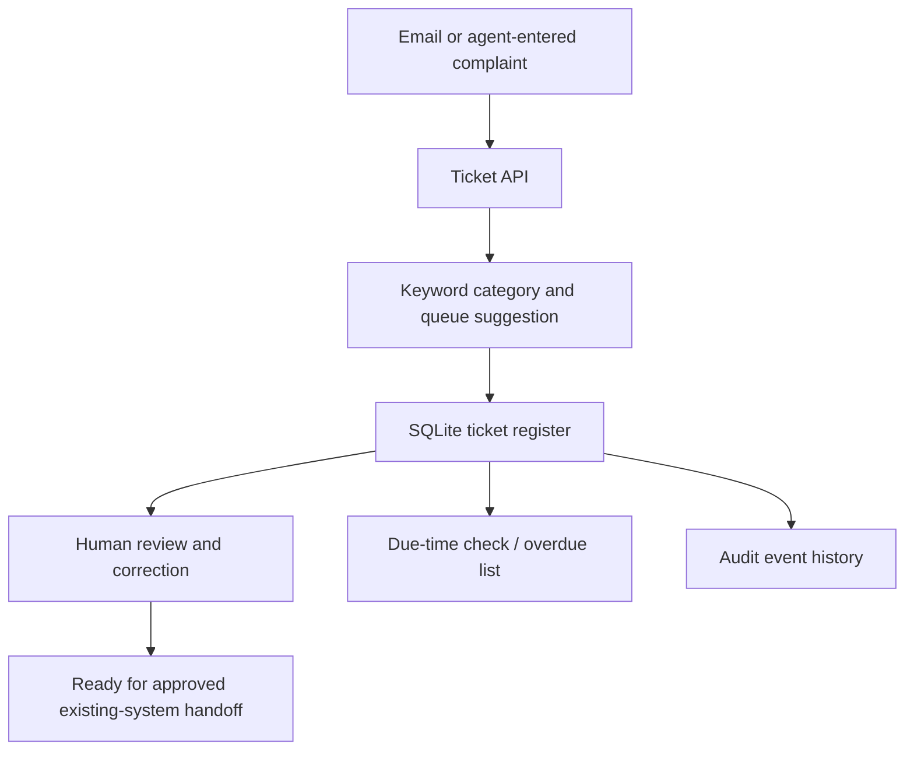

# AI-enabled Customer Grievance Management — MVP

This is a **local demonstration API**, added alongside the Group E follow-up notes. It illustrates a small first step toward the proposed Smart Ticketing System; it is not connected to Nabil's production ticketing system, email, telephone, Viber, social media, or Orbit 360.

## Included
- Create a draft grievance ticket through an API.
- Suggest a category and owning queue using editable keyword rules.
- Assign a unique demo ticket ID and example target-resolution time.
- Require a human review before marking a ticket ready for transfer to an existing system.
- Correct the suggested category/queue during review.
- View tickets, overdue tickets, and ticket audit events.
- Persist tickets in a local SQLite database.

## Requirements
- Python 3.10 or newer
- No third-party Python packages required

## Run locally
From this directory:

```bash
python app.py
```

By default, the API listens on `http://127.0.0.1:8000` and stores its database in `data/grievance.db`. You can set `PORT` or `GRIEVANCE_DB` before starting the app.

## API examples

Health check:

```bash
curl http://127.0.0.1:8000/health
```

Create a ticket draft:

```bash
curl -X POST http://127.0.0.1:8000/tickets \
  -H "Content-Type: application/json" \
  -d '{"channel":"email","message":"My mobile banking login is not working"}'
```

List tickets:

```bash
curl http://127.0.0.1:8000/tickets
```

Review a ticket (replace `GRV-...` with the returned ID):

```bash
curl -X POST http://127.0.0.1:8000/tickets/GRV-XXXXXXXXXX/review \
  -H "Content-Type: application/json" \
  -d '{"decision":"approve","reviewer":"demo-reviewer","note":"Category and queue checked"}'
```

Correct a suggested category/queue:

```bash
curl -X POST http://127.0.0.1:8000/tickets/GRV-XXXXXXXXXX/review \
  -H "Content-Type: application/json" \
  -d '{"decision":"correct","reviewer":"demo-reviewer","category":"digital_banking","queue_name":"Digital Banking Support","note":"Corrected after review"}'
```

List overdue tickets:

```bash
curl http://127.0.0.1:8000/tickets/overdue
```

View audit history:

```bash
curl http://127.0.0.1:8000/tickets/GRV-XXXXXXXXXX/audit
```

## Important limitations and next steps
- The categories, keyword rules, queues, and target times are illustrative placeholders. Confirm them with Operations, Compliance, Risk, and Customer Care before any pilot.
- The overdue endpoint reports tickets past their example due time when queried; this demo does not run a background scheduler or send reminders/escalations.
- Human review is required, but this local demo has no authentication or role-based access control. Do not expose it to the internet or use real customer information.
- Before any real pilot, add authentication, authorization, encryption, retention controls, input/data protections, structured monitoring, tests, and approved integration with the existing ticketing system.
- AI/LLM classification, duplicate detection, customer notifications, workload balancing, dashboards, and live channel connectors are not implemented yet.
- Do not connect this demo to production banking systems or use it to make customer-impacting decisions.

See the parent repository's `Group E - Followups.md` for the broader process and rollout proposal.

## Architecture at a glance



## Suggested implementation sequence
1. **Validate the workflow:** agree categories, queue owners, priority definitions, TAT rules, and escalation policy with business owners.
2. **Pilot intake:** use synthetic or carefully approved test cases and keep all suggested classifications under human review.
3. **Add operational controls:** authentication, role permissions, background reminders, escalation notifications, and monitoring.
4. **Integrate safely:** connect approved channels and the existing ticketing system through documented, access-controlled APIs.
5. **Evaluate before scaling:** track classification accuracy, human correction rate, routing accuracy, acknowledgement time, TAT breaches, reopen rate, and customer satisfaction.

## Integration layer (new)

The API now has a provider-neutral adapter boundary in `integration_layer.py`. By default it uses a **mock adapter** that returns a simulated external ticket ID and makes no network calls.

After a ticket has been human-reviewed, submit it to the mock adapter:

```bash
curl -X POST http://127.0.0.1:8000/tickets/GRV-XXXXXXXXXX/sync \
  -H "Content-Type: application/json" \
  -d '{}'
```

Set `TICKETING_ADAPTER=mock` to make the choice explicit. Setting `TICKETING_ADAPTER=orbit360` intentionally fails closed until an approved Orbit 360 API connector is implemented; it does not make a live connection. The endpoint records a simulated submission in the audit trail and prevents a second submission when one has already been recorded.

### Before implementing the real connector
Obtain the vendor/bank-approved API documentation and confirm authentication method, ticket create/update endpoints, field mapping, assignment/queue identifiers, status mapping, rate limits, retry/idempotency support, error handling, audit requirements, network access, and test/sandbox environment. Store credentials in an approved secrets manager, never in source code. Test with synthetic data first and require security and business approval before production use.
